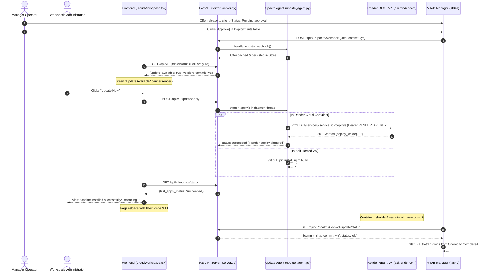

# VTAB Reporting Services — Update Workflow & Architecture

This document provides a comprehensive technical overview of the update agent, Render cloud deployment automation, authentication exemptions, and frontend notification banner in **Reporting Tool Services** (`Reporting Tool Services`).

---

## 1. Architecture Overview

Reporting Services can run in two primary runtime environments:
1. **Self-Hosted / On-Premise VM (e.g. DigitalOcean Droplet, Ubuntu, Docker on Linux/Windows)**:
   - Full filesystem and git CLI access.
   - `trigger_apply()` performs `git pull origin main`, `pip install`, `npm run build`, and server reload locally.
2. **Managed Cloud Container (Render Web Service)**:
   - Read-only / ephemeral container runtime.
   - Container has no GitHub SSH credentials; running `git pull origin main` inside the container causes:
     `fatal: 'origin' does not appear to be a git repository`
   - **Solution**: The update agent integrates with the **Render REST API** to trigger an external container build and rollout directly from Render's runners when the user clicks **"Update Now"**.



---

## 2. Key Enhancements & Code Modifications

### 2.1. Render REST API Deployment Trigger
#### `api/app/update_agent.py`
Implemented `_trigger_render_deploy()` to interface with Render's REST API:
```python
def _trigger_render_deploy() -> dict:
    """Trigger a Render service redeploy via the Render REST API.

    Requires RENDER_API_KEY. Uses RENDER_SERVICE_ID or defaults to production service ID.
    Returns a dict with keys 'ok' (bool) and optionally 'error' or 'deploy_id'.
    """
    api_key = (
        os.environ.get('RENDER_API_KEY') 
        or os.environ.get('RENDER_TOKEN') 
        or os.environ.get('RENDER_API_TOKEN') 
        or ''
    ).strip()
    
    # Defaults to production service ID if not explicitly specified in env
    service_id = (
        os.environ.get('RENDER_SERVICE_ID') 
        or os.environ.get('VTAB_RENDER_SERVICE_ID') 
        or 'srv-dbkmh4d9fdbs73bos7u0'
    ).strip()

    if not api_key:
        logger.warning('RENDER_API_KEY not set in environment variables.')
        return {'ok': False, 'error': 'RENDER_API_KEY is not set in Render environment variables'}
    if not service_id:
        return {'ok': False, 'error': 'RENDER_SERVICE_ID is not configured'}

    url = f'https://api.render.com/v1/services/{service_id}/deploys'
    payload = json.dumps({'clearCache': 'do_not_clear'}).encode('utf-8')
    req = urllib.request.Request(
        url,
        data=payload,
        method='POST',
        headers={
            'Authorization': f'Bearer {api_key}',
            'Content-Type': 'application/json',
            'Accept': 'application/json',
        },
    )
    try:
        with urllib.request.urlopen(req, timeout=15) as resp:
            body = json.loads(resp.read().decode('utf-8'))
            deploy_id = body.get('id') or (body.get('deploy') or {}).get('id')
            logger.info('Render deploy triggered: service=%s deploy_id=%s', service_id, deploy_id)
            return {'ok': True, 'deploy_id': deploy_id}
    except urllib.error.HTTPError as exc:
        detail = exc.read().decode('utf-8', 'ignore')
        logger.warning('Render API error %s: %s', exc.code, detail[:300])
        return {'ok': False, 'error': f'HTTP {exc.code}: {detail[:200]}'}
    except Exception as exc:
        logger.warning('Failed to trigger Render deploy: %s', exc)
        return {'ok': False, 'error': str(exc)}
```

#### Guarding Against Local `git pull` in Cloud Containers
Inside `trigger_apply()`, the runtime detects if it is running on Render or a container:
```python
is_render = bool(
    os.environ.get('RENDER')
    or os.environ.get('RENDER_INSTANCE_ID')
    or os.environ.get('RENDER_SERVICE_ID')
    or os.environ.get('RENDER_API_KEY')
)

if is_render:
    render_result = _trigger_render_deploy()
    if render_result.get('ok'):
        _set_result('deploying', True, 'Render deploy triggered — building in cloud...')
        if deployment_id:
            _report_deployment(deployment_id, 'deploying', 'Render deploy triggered — building in cloud')
        with _STATE_LOCK:
            _pending_deployment = None
            _update_status['update_available'] = False
            _update_status['deployment_id'] = None
            _update_status['current_version'] = ver
        _persist_state('current_offer', None)
        _set_result('succeeded', True, 'Render deploy triggered — your app will reload once the build completes (~2 min)')
        if deployment_id:
            _report_deployment(deployment_id, 'succeeded', 'Render deploy triggered successfully')
        return
    else:
        # In cloud containers, never attempt local git pull; report exact API error!
        err_msg = render_result.get('error') or 'Render deploy failed'
        logger.warning('Render deploy failed: %s', err_msg)
        _set_result('failed', False, f'Render cloud deploy failed: {err_msg}')
        if deployment_id:
            _report_deployment(deployment_id, 'failed', err_msg)
        return
```

---

### 2.2. Authentication & Authorization Middleware Exemptions
#### `api/app/server.py`
1. **Webhook Path Exemption**:
   When `VTAB_ENFORCE_API_AUTH=1` is active, the `secure_authoring_api` middleware checks user sessions for all routes. The update endpoints must allow webhook requests (authenticated via `VTAB_AGENT_TOKEN`):
   ```python
   # Exclude public and update endpoints from user session requirement
   if (
       path.startswith('/api/v1/public')
       or path.startswith('/api/v1/health')
       or path.startswith('/api/v1/update')
   ):
       return await call_next(request)
   ```

2. **Browser Admin Apply Permission**:
   Previously, `/api/v1/update/apply` strictly checked for the machine-to-machine `x-vtab-agent-token` header, returning 403 Forbidden to authenticated browser admins.
   Updated to allow authenticated session users (Supabase admin session) or valid connector tokens:
   ```python
   @app.post("/api/v1/update/apply")
   async def apply_update(request: Request):
       # Allow authenticated browser admins OR connector token
       token = request.headers.get("x-vtab-agent-token") or ""
       user = getattr(request.state, "user", None)
       if not token and not user:
           raise HTTPException(403, "Authentication required to apply updates.")
       # ...
       thread = threading.Thread(target=trigger_apply, daemon=True)
       thread.start()
       return {"status": "applying", "message": "Update initiated."}
   ```

---

### 2.3. Frontend Notification Banner & Polling
#### `src/v11/CloudWorkspace.tsx`
1. **Live Status Polling & Detailed Error Reporting**:
   ```tsx
   const applyServicesUpdate = async () => {
     if (!confirm(`Apply update to version ${updateStatus?.available_version || 'latest'}?`)) return;
     try {
       await api('/update/apply', { method: 'POST' });
       alert('Update started — monitoring build…');
       
       const poll = setInterval(async () => {
         try {
           const d = await api<any>('/update/status');
           setUpdateStatus(d);
           if (d.last_apply_status === 'succeeded' || d.last_apply_status === 'failed') {
             clearInterval(poll);
             if (d.last_apply_status === 'succeeded') {
               alert('Update installed successfully! Reloading...');
               setTimeout(() => location.reload(), 1500);
             } else {
               // Displays exact server error instead of generic "check server logs"
               alert(`Update failed: ${d.last_apply_message || 'check server logs'}`);
             }
           }
         } catch { 
           clearInterval(poll); 
         }
       }, 4000);
     } catch (e: any) { 
       alert(e.message); 
     }
   };
   ```

2. **Green Notification Banner**:
   ```tsx
   {updateStatus?.update_available && (
     <div style={{
       background: '#15803d',
       color: '#fff',
       padding: '10px 20px',
       display: 'flex',
       justifyContent: 'space-between',
       alignItems: 'center',
       fontSize: 13,
       fontWeight: 600
     }}>
       <span>
         🔔 Update available: Reporting Services v{updateStatus.available_version}
         {updateStatus.release_notes ? ` — ${updateStatus.release_notes}` : ''}
       </span>
       <button 
         onClick={applyServicesUpdate}
         style={{
           background: '#fff',
           color: '#15803d',
           border: 'none',
           borderRadius: 4,
           padding: '4px 14px',
           fontWeight: 700,
           cursor: 'pointer'
         }}
       >
         Update Now
       </button>
     </div>
   )}
   ```

3. **Header Branding**:
   The temporary `TEST` badge was verified in production and cleanly removed in commit `45a6c6b`.
4. **Deployed Commit Reporting & Approval Protection**:
   - `update_agent.py` exports `_current_commit()` reading `RENDER_GIT_COMMIT` (injected automatically by Render cloud runners) or `git rev-parse HEAD`. This allows the VTAB Manager to detect that an offered commit is live and automatically transition the deployment from **Offered** to **Completed**.
   - Deployments remain protected behind an explicit **Approval Gate** in the Manager control plane (`Pending approval` state) until an operator explicitly approves rollout before webhooks are dispatched to Services.

---

## 3. Environment Variables Reference

| Variable | Required In | Purpose | Example |
|---|---|---|---|
| `RENDER_API_KEY` | Render Environment | Authenticates with Render REST API to trigger deploys | `rnd_...` |
| `RENDER_SERVICE_ID` | Render / Optional | The Render service ID (defaults to `srv-dbkmh4d9fdbs73bos7u0`) | `srv-dbkmh4d9fdbs73bos7u0` |
| `VTAB_CLIENT_ID` | Render / Self-Hosted | Client ID issued by the Manager control plane | `65805eab-d112-4b8f-b46d-a8f2dcd8cf0b` |
| `VTAB_AGENT_TOKEN` | Render / Self-Hosted | Connector authentication token for Manager webhooks | `vtab_tok_...` |
| `VTAB_MANAGER_URL` | Render / Self-Hosted | Base URL of the VTAB Reporting Manager | `http://127.0.0.1:8840` |
| `VTAB_SIMULATE_BUILD` | Test Only | When set to `1`, simulates build without touching git or Render API | `0` |
