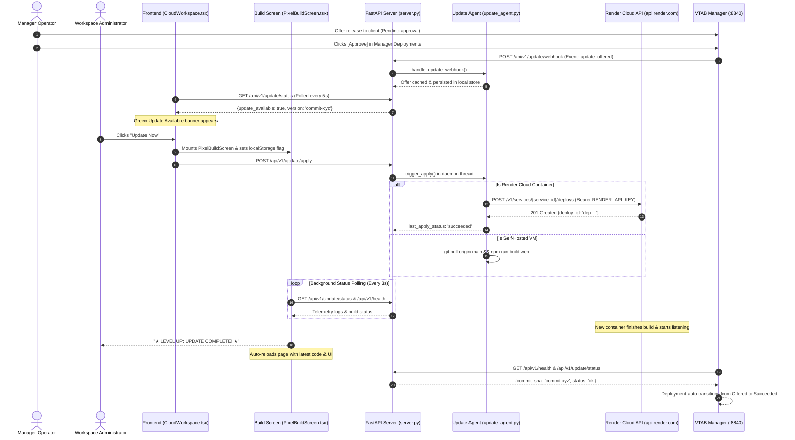

# VTAB Reporting Services — Update Workflow & Architecture

This document provides a comprehensive technical and operational overview of the update system, Render cloud deployment orchestration, security exemptions, retro pixelated build experience, and automated client health reporting in **VTAB Reporting Services** (`Reportingtool-webservice`).

---

## 1. Executive Summary & Architecture

Reporting Services is designed to operate seamlessly across two distinct runtime environments:

1. **Managed Cloud Containers (Render Web Service — Production)**:
   - Read-only, ephemeral container runtime without host GitHub SSH credentials.
   - Container-level `git pull origin main` is prohibited and causes git credential failures.
   - **Cloud Orchestration**: The update agent integrates directly with the **Render REST API** (`https://api.render.com/v1/services/{service_id}/deploys`). When an administrator clicks **"Update Now"**, the backend commands Render to build and deploy the approved commit in the cloud, while the client frontend launches an animated **PixelBuildScreen** to guide the user through the deployment until live health verification triggers an automatic page refresh.

2. **Self-Hosted / On-Premise Virtual Machines (DigitalOcean, Ubuntu, Windows/Linux Server)**:
   - Full filesystem and git CLI access.
   - `trigger_apply()` performs automated `git pull origin main`, dependency installation (`pip install -r api/requirements.txt`), frontend compilation (`npm run build:web`), and process restart locally.



---

## 2. Key Enhancements & Implementation Details

### 2.1. Render REST API Deployment Trigger
#### File: `api/app/update_agent.py`
The agent detects whether it is operating in a cloud container and executes a remote rollout via Render's REST API:

```python
def _trigger_render_deploy() -> dict:
    """Trigger a Render service redeploy via the Render REST API.

    Requires RENDER_API_KEY. Uses RENDER_SERVICE_ID or defaults to production service ID.
    Returns a dict with keys 'ok' (bool) and optionally 'error' or 'deploy_id'.
    """
    api_key = (
        os.environ.get('RENDER_API_KEY') 
        or os.environ.get('RENDER_TOKEN') 
        or os.environ.get('RENDER_API_TOKEN') 
        or ''
    ).strip()
    
    # Defaults to production service ID if not explicitly specified in env
    service_id = (
        os.environ.get('RENDER_SERVICE_ID') 
        or os.environ.get('VTAB_RENDER_SERVICE_ID') 
        or 'srv-dbkmh4d9fdbs73bos7u0'
    ).strip()

    if not api_key:
        logger.warning('RENDER_API_KEY not set in environment variables.')
        return {'ok': False, 'error': 'RENDER_API_KEY is not set in Render environment variables'}
    if not service_id:
        return {'ok': False, 'error': 'RENDER_SERVICE_ID is not configured'}

    url = f'https://api.render.com/v1/services/{service_id}/deploys'
    payload = json.dumps({'clearCache': 'do_not_clear'}).encode('utf-8')
    req = urllib.request.Request(
        url,
        data=payload,
        method='POST',
        headers={
            'Authorization': f'Bearer {api_key}',
            'Content-Type': 'application/json',
            'Accept': 'application/json',
        },
    )
    try:
        with urllib.request.urlopen(req, timeout=15) as resp:
            body = json.loads(resp.read().decode('utf-8'))
            deploy_id = body.get('id') or (body.get('deploy') or {}).get('id')
            logger.info('Render deploy triggered: service=%s deploy_id=%s', service_id, deploy_id)
            return {'ok': True, 'deploy_id': deploy_id}
    except urllib.error.HTTPError as exc:
        detail = exc.read().decode('utf-8', 'ignore')
        logger.warning('Render API error %s: %s', exc.code, detail[:300])
        return {'ok': False, 'error': f'HTTP {exc.code}: {detail[:200]}'}
    except Exception as exc:
        logger.warning('Failed to trigger Render deploy: %s', exc)
        return {'ok': False, 'error': str(exc)}
```

#### Safe Cloud Execution Guard:
Inside `trigger_apply()`, the runtime strictly prevents calling local `git pull` when cloud container environment flags are detected:
```python
is_render = bool(
    os.environ.get('RENDER')
    or os.environ.get('RENDER_INSTANCE_ID')
    or os.environ.get('RENDER_SERVICE_ID')
    or os.environ.get('RENDER_API_KEY')
)

if is_render:
    render_result = _trigger_render_deploy()
    if render_result.get('ok'):
        _set_result('succeeded', True, 'Render deploy triggered — cloud build underway')
        if deployment_id:
            _report_deployment(deployment_id, 'succeeded', 'Render deploy triggered successfully')
        return
    else:
        err_msg = render_result.get('error') or 'Render deploy failed'
        _set_result('failed', False, f'Render cloud deploy failed: {err_msg}')
        if deployment_id:
            _report_deployment(deployment_id, 'failed', err_msg)
        return
```

---

### 2.2. Authentication & Authorization Middleware Exemptions
#### File: `api/app/server.py`
1. **Webhook Path Exemption**:
   When `VTAB_ENFORCE_API_AUTH=1` is enabled, the `secure_authoring_api` middleware enforces active user sessions across endpoints. The update endpoints are exempt so that Manager webhooks authenticated with `X-VTAB-Agent-Token` can deliver deployment offers:
   ```python
   # Exclude public, health, and update endpoints from user session requirement
   if (
       path.startswith('/api/v1/public')
       or path.startswith('/api/v1/health')
       or path.startswith('/api/v1/update')
   ):
       return await call_next(request)
   ```

2. **Dual-Token Apply Permission**:
   `/api/v1/update/apply` accommodates both authenticated browser administrators (Supabase admin session) and automated connectors (`X-VTAB-Agent-Token` header):
   ```python
   @app.post("/api/v1/update/apply")
   async def apply_update(request: Request):
       token = request.headers.get("x-vtab-agent-token") or ""
       user = getattr(request.state, "user", None)
       if not token and not user:
           raise HTTPException(403, "Authentication required to apply updates.")
       # Initiates background apply daemon
       thread = threading.Thread(target=trigger_apply, daemon=True)
       thread.start()
       return {"status": "applying", "message": "Update initiated."}
   ```

---

### 2.3. Frontend Notification Banner & Fast Polling
#### File: `src/v11/CloudWorkspace.tsx`
1. **Fast 5-Second Update Polling**:
   To ensure immediate banner visibility when an operator offers an update in the Manager, polling was accelerated to every 5 seconds (commit `cfb31bc`):
   ```tsx
   useEffect(() => {
     const checkUpdate = async () => {
       try {
         const d = await api<any>('/update/status');
         setUpdateStatus(d);
       } catch {}
     };
     checkUpdate();
     const interval = setInterval(checkUpdate, 5000);
     return () => clearInterval(interval);
   }, []);
   ```

2. **Seamless Trigger & State Persistence**:
   Clicking **"Update Now"** sets `localStorage ('vtab_building_update')` and activates `isBuildingUpdate`:
   ```tsx
   const applyServicesUpdate = async () => {
     const targetVer = updateStatus?.available_version || 'latest';
     if (!confirm(`Apply update to version ${targetVer}? The cloud container will be rebuilt on Render.`)) return;
     try {
       localStorage.setItem('vtab_building_update', targetVer);
     } catch {}
     setIsBuildingUpdate(true);
     try {
       await api('/update/apply', { method: 'POST' });
     } catch (e: any) {
       try { localStorage.removeItem('vtab_building_update'); } catch {}
       setIsBuildingUpdate(false);
       alert(e.message);
     }
   };
   ```

3. **Emerald Gradient Banner**:
   ```tsx
   {updateStatus?.update_available && (
     <div style={{
       background: 'linear-gradient(90deg, #064e3b, #047857)',
       color: '#ecfdf5',
       padding: '6px 16px',
       display: 'flex',
       alignItems: 'center',
       justifyContent: 'space-between',
       fontSize: '13px',
       fontWeight: 500,
       borderBottom: '1px solid #10b981'
     }}>
       <span>🔔 <strong>Update available:</strong> Reporting Services v{updateStatus.available_version}{updateStatus.applying ? ' — Building on server…' : ''}</span>
       {!updateStatus.applying ? (
         <button onClick={applyServicesUpdate} className="btn-update-now">
           Update Now
         </button>
       ) : (
         <span style={{ opacity: 0.85, fontSize: '12px' }}>{updateStatus.last_apply_status || 'In progress…'}</span>
       )}
     </div>
   )}
   ```

4. **Production UI Cleanliness**:
   The temporary debugging `TEST` badge was verified in live production and completely removed in commit `45a6c6b`.

---

### 2.4. Retro Pixelated Build Animation Screen (`PixelBuildScreen.tsx`)
#### File: `src/v11/PixelBuildScreen.tsx`
To replace jarring alerts and prevent intermediate 502/broken states while Render provisions new containers, we introduced a retro arcade/cyberpunk build screen.

#### Highlights & Capabilities:
- **CRT Cyber Terminal Aesthetic**: Scanline shader effect overlay, neon emerald and cyan typography (`#10b981`, `#38bdf8`), dark arcade cabinet frame, and monospace matrix styling.
- **Animated 8-Bit Pixel Rocket**: Pixelated SVG spacecraft featuring animated pulsating plasma thrusters and assembly particle effects.
- **Segmented Chunky Pixel Gauge**: 30-block progressive gauge that tracks build milestones (`0%` $\rightarrow$ `94%` during build, locking to `100%` on live health verification).
- **Live Simulated Telemetry Stream**: Streams real-time operational messages (e.g. Render API dispatch, Vite TypeScript optimization, DuckDB analytics schema checks, and FastAPI uvicorn start).
- **Background Health Verification & Auto-Reload**:
  - Automatically polls `/api/v1/update/status` and `/api/v1/health` every 3 seconds.
  - Tolerates temporary connection drops during Render's container swap.
  - On verified completion, displays **`★ LEVEL UP: UPDATE COMPLETE! ★`** and automatically reloads the application.
- **Persistent & Minimizable**:
  - Maintained across accidental browser reloads via `localStorage ('vtab_building_update')`.
  - Includes a `[MINIMIZE]` toggle shrinking the view to an unobtrusive floating badge (`👾 CLOUD BUILD IN PROGRESS`) if the administrator wishes to continue inspecting reports.

---

### 2.5. Commit SHA Exposure & Automatic Manager Completion
#### File: `api/app/update_agent.py` & `api/app/server.py`
- `update_agent.py` reads `RENDER_GIT_COMMIT` (injected automatically by Render build runners) or `git rev-parse HEAD` and exposes `commit_sha` on `/api/v1/update/status`.
- This enables the VTAB Reporting Manager to verify that the target commit is live and automatically transition the deployment from **Offered** $\rightarrow$ **Succeeded** without manual operator intervention.
- Hard safety: Deployments remain locked behind an explicit **Approval Gate** in the Manager (`Pending approval`) until authorized by an operator.

---

## 3. Environment Variables Reference

| Variable | Required In | Purpose | Default / Example |
|---|---|---|---|
| `RENDER_API_KEY` | Render Cloud | Authenticates with Render REST API to trigger deploys | `rnd_...` |
| `RENDER_SERVICE_ID` | Render Cloud | The Render Web Service ID | `srv-dbkmh4d9fdbs73bos7u0` |
| `VTAB_CLIENT_ID` | All Environments | Client ID issued by Manager control plane | `65805eab-d112-4b8f-b46d-a8f2dcd8cf0b` |
| `VTAB_AGENT_TOKEN` | All Environments | Connector authentication token for webhooks | `vtab_agent_token_live_2026` |
| `VTAB_MANAGER_URL` | All Environments | Base URL of VTAB Reporting Manager | `http://127.0.0.1:8840` |
| `VITE_SUPABASE_URL` | Web & Backend | Supabase project URL shared with Manager | `https://asjscibujiikthxmpxgg.supabase.co` |
| `SUPABASE_SERVICE_ROLE_KEY` | Backend Only | Server-only administrative key | `eyJhbGciOiJI...` |
| `VTAB_SIMULATE_BUILD` | Local Testing | When set to `1`, simulates build without cloud API calls | `0` |

---

## 4. Verification & Testing Checklist

- [x] **Webhook Delivery**: Manager dispatches `update_offered` to `/api/v1/update/webhook` with `200 OK`.
- [x] **Banner Display**: Frontend detects update within 5 seconds and renders emerald banner.
- [x] **Authentication Safety**: Session-authenticated browser admin can trigger `/api/v1/update/apply` without 403 error.
- [x] **PixelBuildScreen Activation**: Screen mounts immediately upon clicking "Update Now" and persists across page reloads.
- [x] **Render API Rollout**: Remote deploy triggered on Render with status tracking.
- [x] **Zero Regressions**: Core report authoring, multi-workspace sharing, and DuckDB queries remain completely unaffected.
